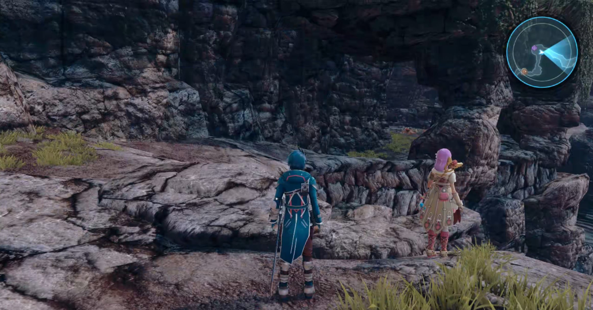

# Star Ocean: Integrity and Faithlessness (PS4, CUSA03219): PS4RT for PC Linux Port

A game-specific Linux compatibility runtime for **Star Ocean: Integrity and Faithlessness**
(PlayStation 4, **CUSA03219**), tested on **Fedora Linux and Steam Deck, x86-64**.

PS4RT prepares and runs the game's original x86-64 code on a Linux host, supplies
compatibility implementations of the PS4 services it needs, and uses a Vulkan
graphics renderer derived from shadPS4. This is **not a general-purpose PS4
emulator**, a native recreation of the game, or a replacement for owning the
game.

<p align="center">
  
</p>

**No game files, firmware, PKGs, decryption keys, or saves are supplied.** You
must provide your own extracted, plaintext **CUSA03219** game folder. The
portable does not download games or connect to PSN. This project is not
affiliated with Square Enix, Sony, or AMD.

## Download and play (no compiling required)

**Want to play? Use the prebuilt Linux release. You do not need to compile
PS4RT or install FFmpeg, SDL3, or other bundled application libraries.**

1. **Download v1.2:** Use the [Star Ocean: Integrity and Faithlessness PS4RT v1.2 release](https://github.com/HekamiAeon/Star-Ocean-Integrity-and-Faithlessness-PS4RT/releases/tag/v1.2) (also the [latest release](https://github.com/HekamiAeon/Star-Ocean-Integrity-and-Faithlessness-PS4RT/releases/latest)). Download **`star-ocean-5-ps4rt-linux-x86_64-7010cc2.tar.gz`** to play; the `source` archive is for developers. The superseded v1.1 release remains available for rollback.
2. **Have your own extracted PS4 game:** The launcher needs a plaintext **`CUSA03219` folder** containing `sce_sys/param.sfo`, `eboot.bin`, `sce_module/`, and the game's data. Point to **the CUSA03219 folder itself**, not a PKG, its parent folder, or `eboot.bin`.
3. **Extract the downloaded archive** using your file manager. Open a terminal inside its extracted folder.
4. **Launch** with the path to your extracted `CUSA03219` folder:

```bash
bash Play-Game.sh --game "/path/to/CUSA03219"
```

**After a successful first setup**, the validated game folder is remembered inside the portable. For future launches, simply run `bash Play-Game.sh`. Supply `--game` again if you move the extracted folder or want to select a different copy. The `Play-Star-Ocean.sh` command from previous versions remains as an alias for existing shortcuts.

**That's all you need to begin setup.** Keep the extracted release folder
together and writable. Paths containing spaces must be inside quotes, as
shown. The first run prepares the game's working files inside the portable;
your extracted game folder is read, not modified.

**Graphics are controlled in-game.** Hold **L2** and click the right stick
(**R3**) to open PS4RT settings, or press **Insert** on a keyboard. Use the
D-pad to navigate, Cross to confirm, and Circle to go back. Choose output
**Internal resolution** (16:9 or experimental ultrawide), **FSR Upscale
output**, upscaling (**Off, FSR 1, FSR 3.1, or FSR 4 v07**, where supported),
sharpening, anisotropic filtering, and the Star Ocean-specific options below.

**Internal resolution and FSR output are separate settings.** The game's scene
can render at 1024×576 (low-end "540p"), 1280×720, 1920×1080, 2560×1440,
or 3840×2160, plus experimental **21:9, 24:9, and 32:9** modes up to
5120×1440. **Changing internal resolution requires restarting.** FSR output
is selected separately, within the same aspect-ratio family; choosing a
higher output does not change how many pixels the game renders internally.
FSR 1 is lightweight spatial upscaling without temporal anti-aliasing; FSR 3.1
and FSR 4 v07 use temporal reconstruction. FSR and its output selection apply
live where supported.

**Changing anisotropic filtering (AF) or graphics quality requires restarting
the game.** Use **Restart Game** in the PS4RT overlay after saving progress.

**Player requirements:** x86-64 Linux with glibc **2.35 or newer**, Python 3,
a working Vulkan loader/driver (Vulkan 1.3), and compatible host display/input
libraries. Required application libraries, including SDL3 and FFmpeg, are
bundled. No compiler or special `LD_LIBRARY_PATH` command is needed. Fedora
and Steam Deck gameplay has been verified; other Linux distributions and
hardware combinations are not all validated.

**Architecture support:** The portable targets native **x86-64/AMD64** CPUs.
ARM64 devices and CPU translation layers such as FEX or Box64 are **not
supported or validated**.

For more help, see [Running on Linux](docs/RUNNING_LINUX.md). The release
does **not** contain PS4 game files or firmware.

## Current status

- SDL-compatible gamepads, including DualSense and XInput, plus keyboard
  controls.
- **Internal resolution:** 1024×576, 720p, 1080p, 1440p, and native 4K,
  plus experimental **21:9 (2560×1080, 3440×1440), 24:9 (3840×1440),
  and 32:9 (3840×1080, 5120×1440)**. A change requires restarting the game.
- **FSR Upscale output:** Select the output separately from internal resolution;
  only compatible same-aspect outputs are offered. Upscaling options are **Off,
  FSR 1, FSR 3.1, and FSR 4 v07** (GPU support permitting). Higher output
  resolutions do not necessarily mean the scene is rendered at that size.
- **Graphics quality (v1.3):** **Max (original)** preserves the game's effects; **High** draws lower-resolution shadows. **Low** draws them lower still and disables ambient occlusion. A change requires restarting the game.
- **Anisotropic filtering:** Game default, 2×, 4×, 8×, or 16×. AF is separate
  from anti-aliasing and requires restarting the game.
- **Custom Star Ocean PS4RT overlay**, with artwork and menu sounds.
  Open using **Insert** or **L2 + R3 click**. Settings are saved when the
  overlay closes.
- **Framerate:** **60 (original)** is the game's own rate and remains the
  default. **30** locks the game to an even 30 FPS for slower GPUs that
  cannot hold 60; game speed stays the same. The choice applies live.
- **Asynchronous compilation:** **ON** (default) gives smoother first-use
  shader loading, with occasional brief visual flickers. **OFF** gives
  occasional shader-loading stutters, with more reliable rendering. The
  setting applies live.
- **Restart Game:** Closes the current running game and launches it again
  through the PS4RT launcher.
- **Local achievements:** Game-triggered trophies are saved locally and shown
  in the **Achievements** tab with icons, progress, hidden entries, unlock
  timestamps, and notifications. These are **not synced with PSN**; objectives
  completed before the feature was added will not unlock retroactively.
- **Game language:** An overlay dropdown switches the game language
  between **English and French**. The setting also controls
  trophy-text localization.
- **Ultrawide:** The 21:9, 24:9, and 32:9 modes widen the rendered scene but
  remain **experimental**. Some HUD, dialogue, and cutscene elements may retain
  16:9 layout assumptions. Return to 16:9 when investigating visual defects.


FSR 1 (spatial) and FSR 3.1 (temporal) are available in the runtime. FSR 4
v07 assets and their license notice are included under `fsr4_shaders/`.
FSR 4 requires appropriate Vulkan GPU features, including INT8 dot-product
support; unsupported hardware can use **FSR 3.1, FSR 1, or Off** instead.
These assets are upscaler dependencies, not shaders extracted from the game.

### Known limitations and bug reports

- **DrawPipeline is unsupported and off by default.** Enabling it may help
  CPU-limited systems but can cause flickering or missing UI/fade draws.
  Bug reports must reproduce with DrawPipeline off. To experiment:

```bash
PS4RT_DRAW_PIPE=1 bash Play-Game.sh --game "/path/to/CUSA03219"
```

Disable it again with `PS4RT_DRAW_PIPE=0` or leave the variable unset.
Please use [GitHub Issues](https://github.com/HekamiAeon/Star-Ocean-Integrity-and-Faithlessness-PS4RT/issues)
for reports. Include the chapter/scene and your graphics settings.

## Build from source (developers only)

**Downloaded the prebuilt Linux release? Skip this section.** The commands
below are for contributors. Players should use `Play-Game.sh` as shown
above.

From a source checkout, install a C/C++ toolchain, CMake 3.24+, Ninja,
pkg-config, Python 3, glslang, and development packages for Vulkan, SDL3,
FFmpeg, X11, fmt, Boost, xxHash, robin-map, Zydis, and other source
dependencies. Exact package names vary by distribution.

```bash
PS4RT_LTO=OFF bash build.sh --test
bash run.sh --game "/path/to/CUSA03219"
```

The test build runs automated tests, not a full playthrough. Source builds
create generated runtime data under `out/CUSA03219/`.

To create the portable Linux release using the controlled Ubuntu 22.04 /
GCC 14 / glibc 2.35 builder, see [Linux portable build instructions](packaging/linux/README.md)
and the [distribution guide](docs/DISTRIBUTING_LINUX.md).

### Keyboard and controller remapping

Default keyboard controls include **WASD** (left stick), **arrow keys**
(right stick), **Space** (Cross), **Left Shift** (Circle), **E** (Square),
**Q** (Triangle), and **I/J/K/L** (D-pad).

You can remap PS4 buttons at launch using `PS4RT_KEY_MAP`:

```bash
PS4RT_KEY_MAP="cross=Q,triangle=Space" bash run.sh --game "/path/to/CUSA03219"
```

`PS4RT_PAD_MAP` similarly remaps gamepad buttons. These are environment
variables, **not settings in `ps4rt.ini`**. There is no in-game
key-binding editor. The mapping defaults live in
[`src/runtime_pad.c`](src/runtime_pad.c), and these remaps do not change
analog axes or the PS4RT menu shortcut.

### Saves and private files

The source checkout or extracted portable keeps generated game code,
settings, saves, and GPU caches under `out/CUSA03219/`.
Notable paths:

- `out/CUSA03219/ps4rt.ini`: saved graphics settings.
- `out/CUSA03219/user/savedata/`: user save data.
- `out/CUSA03219/user/savedata-backups/`: save backups, when present.
- `out/CUSA03219/user/achievements/`: local unlock state and generated trophy
  catalog.
- `out/CUSA03219/user/gpu/cache/CUSA03219/`: GPU shader/pipeline caches,
  when present.

**Never publish `out/CUSA03219/`.** It can contain game-derived binaries,
private saves, and caches. No proprietary game material or
user data belongs in source control or public player archives.

## Credits, origins, and license

This Star Ocean-specific project is **adapted open-source compatibility
software**, not a clean-room implementation. Its runtime builds on work
from:

- [FelipePrado0/gow3_pc](https://github.com/FelipePrado0/gow3_pc),
  the original PS4 compatibility-runtime lineage.
- [deadinside28/bloodborne_pc](https://github.com/deadinside28/bloodborne_pc)
  and [Supermedo/bloodborne_pc](https://github.com/Supermedo/bloodborne_pc),
  earlier compatibility-runtime and launcher adaptations.
- [shadPS4](https://github.com/shadps4-emu/shadPS4) and related Vulkan
  renderer and shader-recompiler contributors.

Development used [REA: Reverse Engineer Anything](https://github.com/morluto/rea)
and [Ghidra](https://github.com/NationalSecurityAgency/ghidra) as
reverse-engineering analysis tools, not embedded runtime code.

See [Upstream credits and notices](docs/UPSTREAM_CREDITS.md) for
additional contributors and third-party licenses. The runtime source is
distributed under **GPL-2.0-or-later**; vendored components retain their
own licenses and attribution. The FSR 4 assets have a separate notice at
[fsr4_shaders/LICENSE-FSR4-v07.txt](fsr4_shaders/LICENSE-FSR4-v07.txt).
A separate repository name or Git history does not remove obligations
to upstream contributors.

Star Ocean is a trademark of its respective owners. This project is
not affiliated with or endorsed by them.
