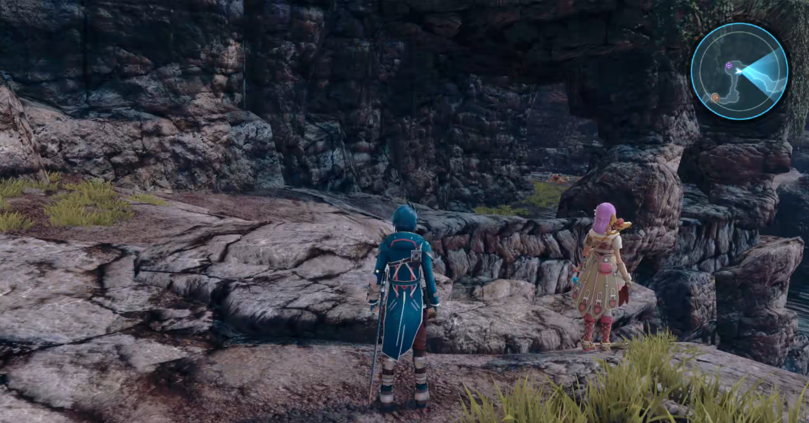

# Star Ocean 5: Integrity and Faithlessness — PS4RT for PC Linux Port

An experimental, game-specific Linux compatibility runtime for **Star Ocean: Integrity and Faithlessness**
(PlayStation 4, **CUSA03219**), tested on **Fedora Linux, x86-64**.

PS4RT prepares and runs the game's original x86-64 code on a Linux host, supplies
compatibility implementations of the PS4 services it needs, and uses a Vulkan
graphics renderer derived from shadPS4. This is **not a general-purpose PS4
emulator**, a native recreation of the game, or a replacement for owning the
game.

<p align="center">
  
</p>

**No game files, firmware, or decryption tools are supplied.** You must provide
your own extracted, plaintext CUSA03219 game folder. The launcher does not
download games, decrypt encrypted packages, or connect to PSN. This project is
not affiliated with Square Enix, Sony, or AMD.

## Current status

**Experimental and playable through tested early-story sections; not a verified
full playthrough.** Tested on Fedora with an **AMD Ryzen 7 9700X** CPU and
**NVIDIA GeForce RTX 3080 Ti** and **AMD Radeon RX 9070 XT-class**
graphics (the AMD hardware used was a **Radeon AI PRO R9700**). Verified
gameplay includes the introduction, story cinematics, menus, audio,
controller input, town exploration, battles, and save/load progression
through **Chapter 4**.
4K output with FSR 4 v07 has also been tested. Other hardware
configurations, Linux distributions, and the full game have not
been independently verified.

- SDL-compatible gamepads, including DualSense and XInput, plus keyboard controls.
- Output at **1080p, 1440p, or 4K**, with **FSR 3.1**, optional **FSR 4 v07**,
  and sharpening controls.
- **Anti-aliasing (AA)** is provided through the selected FSR reconstruction
  mode. Sharpening is a separate image adjustment.
- **Anisotropic filtering (AF)** is separate from AA: choose Game default,
  2×, 4×, 8×, or 16×. AF changes require restarting the game.
- Custom illustrated PS4RT in-game graphics overlay with menu sound effects.
  Open it with **Insert**, or press **L2 + R3 click**. Navigate with the D-pad,
  confirm with Cross, and go back with Circle.
- **Synchronous / asynchronous shader compilation** is selectable live from
  the in-game overlay, with the choice saved when the overlay closes:
  - **Sync (default):** occasional stutters while new shaders load, with
    more reliable rendering.
  - **Async:** smoother gameplay during shader loading, with occasional brief
    visual flickers in some areas.
- **Exit Game** in the graphics menu requests confirmation before returning
  to the Linux desktop. Save your in-game progress first; this action does
  not trigger an automatic game save.
- Higher output resolutions use reconstruction/upscaling rather than a claim
  of native 4K game rendering.
- Original game frame-rate behavior is retained; no bundled 60 FPS patch or
  frame-generation gameplay mode is claimed.

FSR 3.1 is available in the runtime. The FSR 4 **v07** shader/model assets
and their license notice are included in `fsr4_shaders/`; hashes and provenance
are recorded in `packaging/fsr4-v07-assets.json`. FSR 4 requires compatible
Vulkan GPU features and otherwise falls back to FSR 3.1. These are **upscaler
dependencies**, not cached shaders compiled from the game.

## Quick start: Linux source checkout

A prebuilt game archive is not included in this source repository. Build the
runtime and provide **your own extracted CUSA03219 game directory**.

From the root of the repository:

```bash
PS4RT_LTO=OFF bash build.sh --test

bash run.sh \
  --game /path/to/your/CUSA03219 \
  --upscaler fsr4 \
  --output-resolution 4k
```

The FSR and 4K arguments are optional launch overrides. You can also start
with `bash run.sh --game /path/to/your/CUSA03219` and choose graphics
options through the in-game overlay. The game directory must contain
`sce_sys/param.sfo`, the extracted main game binary, required modules,
and game data. The launcher uses the originals to prepare private working
files under `out/` and does not modify your original extraction.

**Source requirements:** Linux x86-64, Python 3, a C/C++ compiler, CMake,
Ninja, pkg-config, a Vulkan loader and compatible graphics driver,
and development libraries for SDL3, FFmpeg, and the additional dependencies
used by the included CMake project. Fedora is the tested environment;
other distributions may require dependency adjustments.

## Build from source

Install a C/C++ toolchain, CMake, Ninja, pkg-config, Python 3, and development
packages for Vulkan, SDL3, FFmpeg, fmt, Boost, xxhash, robin-map, Vulkan
Memory Allocator, Zydis, glslang, and X11. Third-party source dependencies
required by the build are included in this repository.

Build and run:

```bash
PS4RT_LTO=OFF bash build.sh --test
bash run.sh --game /path/to/your/CUSA03219
```

The `--test` build runs the project's automated tests as well as compiling
the runtime. A successful test suite does not establish full-game
compatibility.

For the full control layout, launch options, and troubleshooting, see
[Running on Linux](docs/RUNNING_LINUX.md). For dependency, packaging, and
source-distribution details, see the
[Linux distribution guide](docs/DISTRIBUTING_LINUX.md).

### Keyboard and controller remapping

Default keyboard controls include **WASD** (left stick), **arrow keys**
(right stick), **Space** (Cross), **Left Shift** (Circle), **E** (Square),
**Q** (Triangle), and **I/J/K/L** (D-pad).

You can remap PS4 buttons at launch through `PS4RT_KEY_MAP`:

```bash
PS4RT_KEY_MAP="cross=Q,triangle=Space" \
  bash run.sh --game /path/to/your/CUSA03219
```

`PS4RT_PAD_MAP` similarly remaps gamepad buttons. These are launch-time
environment variables, **not keys in `ps4rt.ini`**; there is currently
no in-game key-binding editor. Default mappings and keyboard stick axes
are defined in [`src/runtime_pad.c`](src/runtime_pad.c). These button maps
do not remap the analog stick axes or the PS4RT menu shortcut.

### Saves and private files

The source checkout stores generated game code, settings, saves, and GPU
caches under `out/CUSA03219/`. Notable paths include:

- `out/CUSA03219/ps4rt.ini`: saved in-game graphics settings.
- `out/CUSA03219/user/savedata/`: game save data.
- `out/CUSA03219/user/savedata-backups/`: save backups, when present.
- `out/CUSA03219/user/gpu/cache/CUSA03219/`: generated GPU shaders
  and pipeline caches, when present.

**Never publish the `out/` directory.** Prepared game executables and
linked data can contain proprietary game material, while savedata and caches
belong to individual players. None of these belong in source control or
release archives.

## Credits, origins, and license

This Star Ocean-specific project is **adapted open-source compatibility
software**, not a clean-room implementation. Its runtime builds on work from:

- [FelipePrado0/gow3_pc](https://github.com/FelipePrado0/gow3_pc), the
  God of War III compatibility-runtime project from which the porting
  runtime was adapted.
- [deadinside28/bloodborne_pc](https://github.com/deadinside28/bloodborne_pc)
  and [Supermedo/bloodborne_pc](https://github.com/Supermedo/bloodborne_pc),
  earlier Bloodborne PC runtime and launcher lineage.
- [shadPS4](https://github.com/shadps4-emu/shadPS4) and related Vulkan
  renderer and shader-recompiler contributors.

Development also used [REA: Reverse Engineer Anything](https://github.com/morluto/rea)
and [Ghidra](https://github.com/NationalSecurityAgency/ghidra) as
reverse-engineering **analysis tools**, not embedded runtime code.

See [Upstream credits and notices](docs/UPSTREAM_CREDITS.md) for additional
contributors, source provenance, and third-party licenses. Original authors'
copyright and license notices remain in the source tree. The project's
runtime source is distributed under **GPL-2.0-or-later**; vendored components
retain their respective terms. A separate project name and fresh Git history
do not change those obligations.
